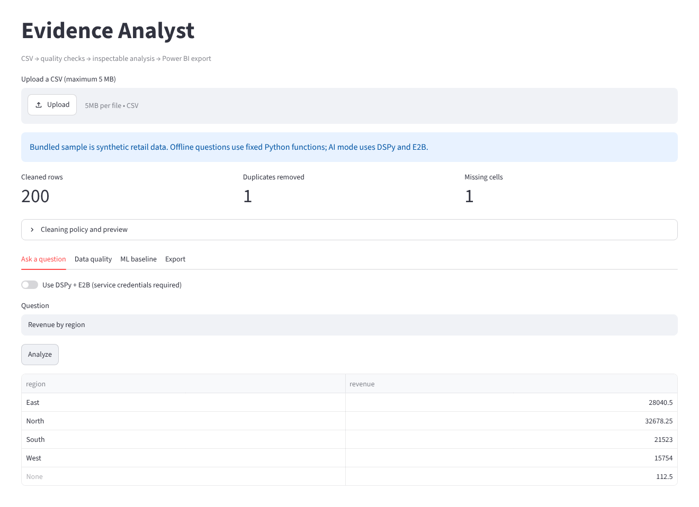
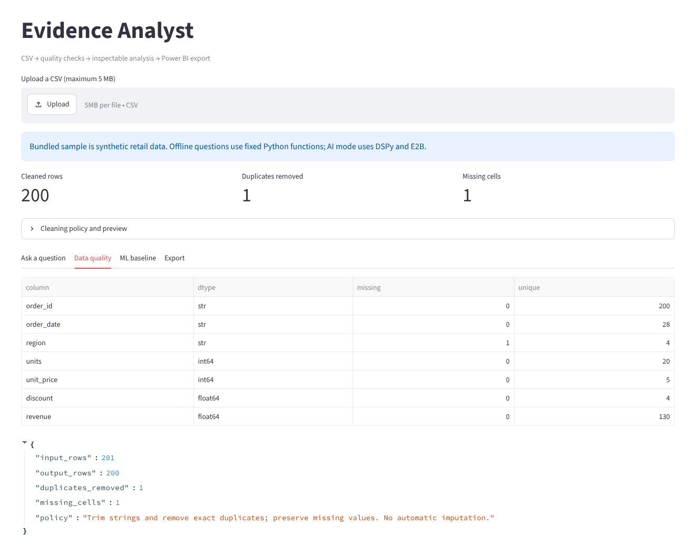
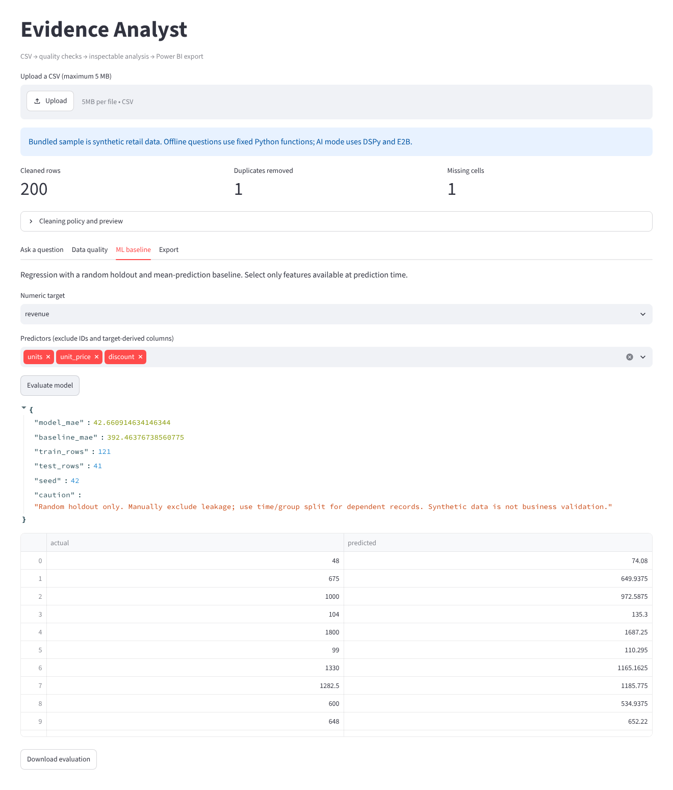
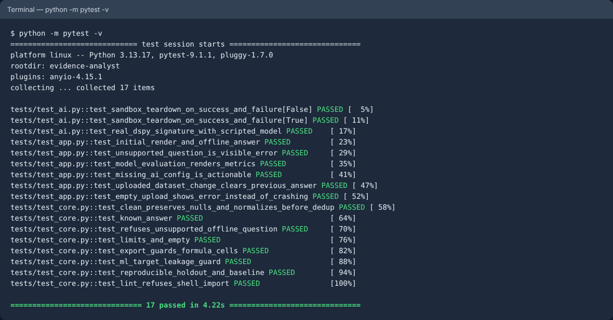
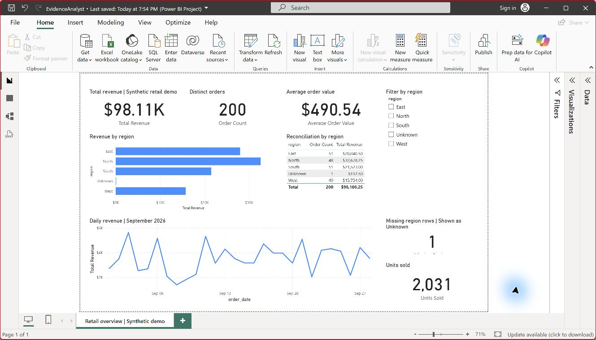
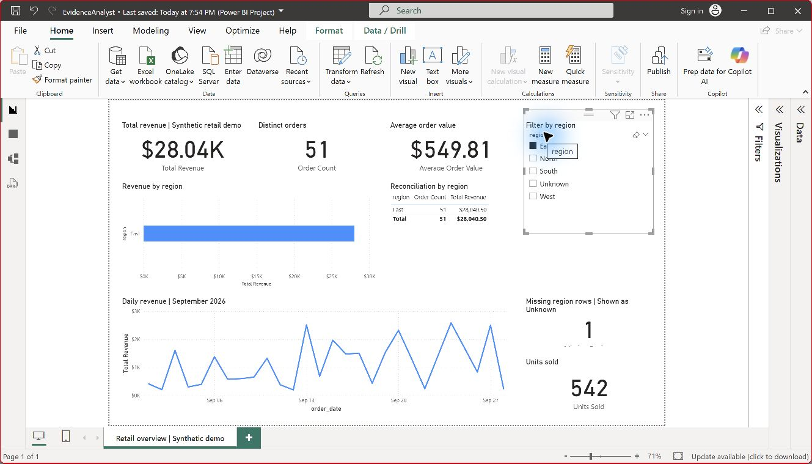
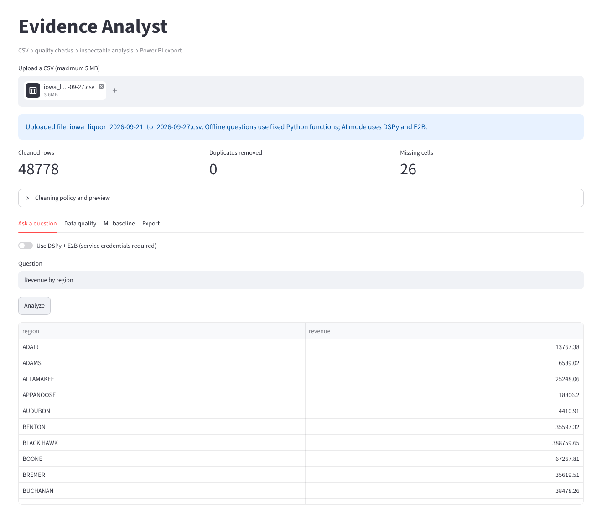
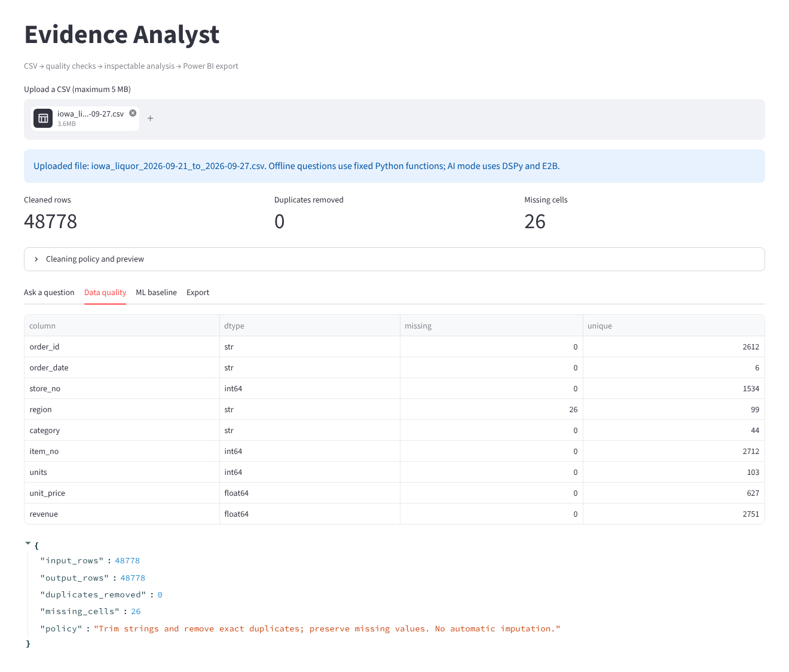
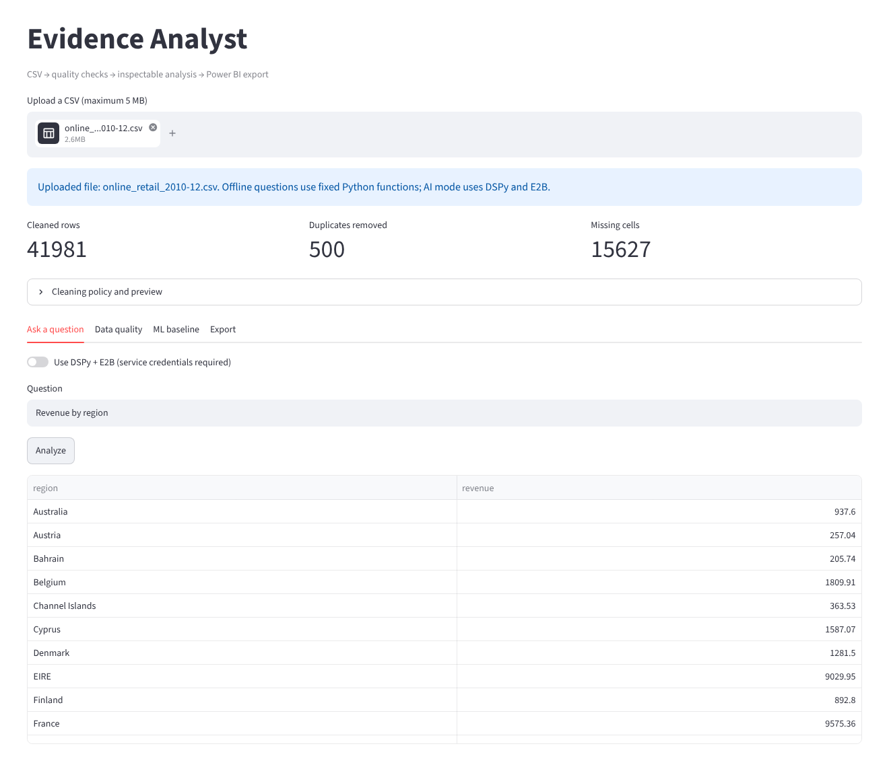
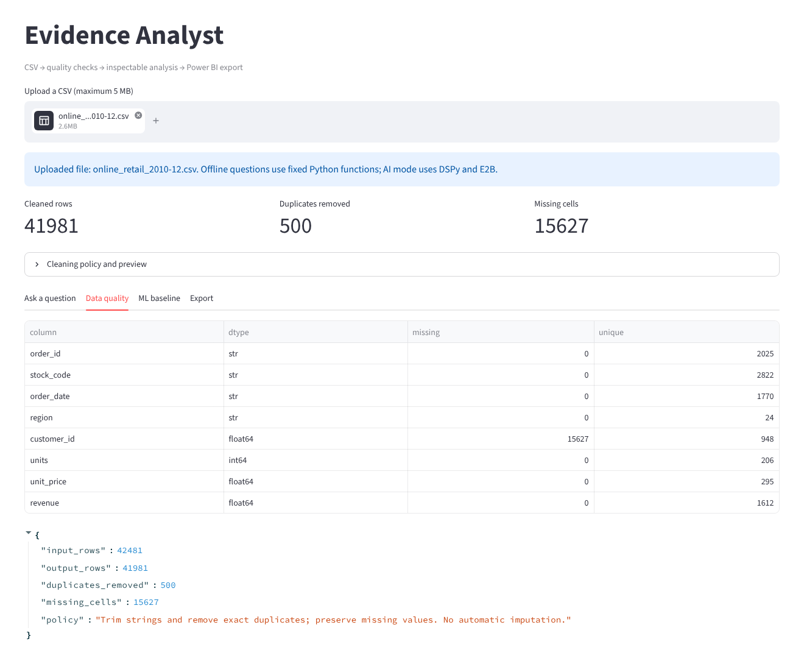

# Evidence Analyst

An inspectable CSV analysis workbench: upload data, review quality checks, ask a question, compare a regression model with a baseline, and export tables for Power BI.


**Stack:** Python · pandas · scikit-learn · Streamlit · DSPy · E2B · Power BI (PBIP/DAX) · pytest · GitHub Actions

## Screenshots

All screenshots are real output from the bundled synthetic dataset, not mockups.

| Ask a question (offline mode) | Data quality profile |
|---|---|
|  |  |

| ML baseline: Random Forest vs mean prediction | Automated test suite |
|---|---|
|  |  |

**Native Power BI report** (Power BI Desktop, `powerbi/project/EvidenceAnalyst.pbip`):



Region slicer set to East (51 orders, $28,040.50, which matches the app's Revenue by region answer):



## Run

Python 3.11+ recommended. From this directory:

```powershell
python -m venv .venv
.venv\Scripts\Activate.ps1
pip install -r requirements.txt
streamlit run app.py
```

Offline artifact reproduction (only pandas and scikit-learn required):

```powershell
python demo.py
```

Full automated suite (install requirements.txt first):

```powershell
python -m pytest -q
```

The sample contains 201 synthetic retail rows, one exact duplicate and one missing region. Cleaning removes the duplicate and preserves the missing value. No real customers or financial outcomes are represented.

## Verified on real 2026 US data

The app has been run on the most recent complete week (21–27 September 2026) of **Iowa Liquor Sales, 2026**, the State of Iowa's official record of every spirits purchase by licensed stores. Upload `data/iowa_liquor_2026-09-21_to_2026-09-27.csv` to reproduce it, or rebuild it from the publisher with `python scripts/prepare_iowa_2026.py` (about a 400 MB download).

| Check | App result | Independent check |
|---|---|---|
| Sales lines | 48,778 (no exact duplicates that week) | same |
| Missing cells (county not recorded, kept as missing) | 26 | same |
| Counties | 99, plus lines with no county | same |
| Total sales, all counties | $8,090,651.73 | same, to the cent |
| Polk County (Des Moines) | $1,903,101.82 | same, to the cent |

| 2026 data: Revenue by county | 2026 data: quality profile |
|---|---|
|  |  |

Real-data findings the app surfaces: 26 sales lines have no county; 30 lines are returns (negative bottles); and 963 lines have a sales total that differs from bottles × listed retail price by more than a cent, so `revenue` is used as published rather than recomputed. Store numbers with leading zeros (for example `010604`) are read as numbers by pandas and lose the zero; this does not affect totals.

Dataset credit: Iowa Department of Revenue, Alcohol Operations Bureau, *Iowa Liquor Sales, 2026*, [data.iowa.gov dataset 1263](https://data.iowa.gov/catalog/dataset/1263), licensed [CC BY 4.0](https://creativecommons.org/licenses/by/4.0/). The repository includes a column-mapped one-week extract; the mapping is in the prep script.

### Second real dataset: UCI Online Retail

The app has also been run on one real month (December 2010) of the **UCI Online Retail** dataset: real UK e-commerce transactions, not pre-cleaned. Upload `data/online_retail_2010-12.csv` in the app to reproduce it, or rebuild the file from the original source with `python scripts/prepare_online_retail.py` (needs `openpyxl`; checks the download's SHA-256).

| Check | App result | Independent check |
|---|---|---|
| Rows in → after cleaning | 42,481 → 41,981 | same |
| Exact duplicates removed | 500 | same |
| Missing cells (customer IDs, kept, not imputed) | 15,627 | same |
| Countries | 24 | same |
| Net revenue, all countries | £746,723.61 | same, to the penny |
| United Kingdom revenue | £674,615.86 | same, to the penny |

The independent check does not use pandas: it uses Python's `csv` module and exact `Decimal` arithmetic. `tests/test_real_data.py` locks these answers in, so CI re-verifies them on every push. Revenue is net of 789 cancellation lines (negative quantities), which are kept because they are real refunds.

| Real data: Revenue by region | Real data: quality profile |
|---|---|
|  |  |

Dataset credit: Daqing Chen, *Online Retail*, UCI Machine Learning Repository (2015), [doi:10.24432/C5BW33](https://doi.org/10.24432/C5BW33), licensed [CC BY 4.0](https://creativecommons.org/licenses/by/4.0/). The repository includes a column-mapped extract of one month; the mapping is in the prep script.

## Two analysis paths

Offline mode supports four explicit question forms: `How many rows?`, `Show missing values`, `Summarize numeric columns`, and `Revenue by region`. These are fixed functions, not LLM output.

AI mode uses a DSPy typed signature to generate Python from column names/types and the question. Review the generated code, then authorize uploading the CSV to an isolated E2B sandbox. The sandbox runs pandas/scikit-learn code and returns answer.csv. Generated Python never executes on the app host. No dataset rows are intentionally sent to the LLM, but schema names and the question are; E2B receives the full cleaned CSV.

Set service credentials in the terminal before launching; never commit them:

```powershell
$env:LLM_MODEL = 'provider/model'
# Set the provider API key in its standard environment variable.
$env:E2B_API_KEY = 'your-key'
```

DSPy generates code here; no DSPy optimizer training or improvement claim is made. E2B and the LLM require accounts and may incur charges. Use synthetic/non-sensitive data only.

## ML evaluation

Numeric regression uses a fixed random holdout, training-only median imputation, a Random Forest, and a mean-prediction baseline. Exact duplicate predictor/target records are removed before splitting. Rows without a target are excluded. Displayed train/test counts therefore can be smaller than the cleaned row count. This is an educational demo, not a general AutoML system. IDs, target-derived features and time/group leakage still require manual review. The retail target is calculated from units, price and discount: its easy predictability is not evidence of business impact.

## Boundaries and current status

- 21 automated tests pass, covering the core, Streamlit interactions, uploaded-dataset changes, mocked sandbox cleanup, and known answers on two real datasets (Iowa Liquor Sales 2026 and UCI Online Retail). A real DSPy signature is tested with a scripted model.
- Live AI mode verified on October 24, 2026: DeepSeek via DSPy generated the code and a live E2B sandbox ran it, matching a known answer (`docs/live-check-2026-10-24.txt`). Using it requires your own LLM and E2B keys.
- A native Power BI project is included at `powerbi/project/EvidenceAnalyst.pbip`, with embedded synthetic data, DAX measures and nine visuals. See `powerbi/README.md` and `VALIDATION.txt` for Desktop validation status.
- UI verification status is recorded in VALIDATION.txt.
- File limit: 5 MB at the upload widget, 50,000 rows and 100 columns checked after CSV parsing. This is not a hardened public upload service.
- E2B internet access is disabled and sandbox lifetime/execution are bounded. Import lint is not a security sandbox. Generated code can still manipulate data and files inside its sandbox; inspect results.
- CSV formula prefixes in text cells are escaped on export. No authentication, rate limits, durable audit store, or production deployment is included.
- Computer vision is deferred. A future extension can convert image detections to tabular counts for this same analysis workflow.

## Architecture

`Streamlit → pandas validation/cleaning → fixed analysis OR DSPy → reviewed code → E2B → result table → CSV bundle → Power BI`

Each AI run uses a new sandbox, destroyed in a finally block. The provider API key is used by DSPy on the host and is not intentionally injected into the sandbox.

## Sources checked October 23, 2026

- [DSPy setup](https://dspy.ai/current/getting-started/installation/)
- [DSPy signatures](https://dspy.ai/current/getting-started/expanding-signatures/)
- [E2B quickstart](https://docs.e2b.dev/quickstart)
- [E2B file access](https://docs.e2b.dev/filesystem/read-write)
- [Power BI project report format](https://learn.microsoft.com/en-us/power-bi/developer/projects/projects-report)
- [Microsoft's PBIR version 2 sample](https://github.com/microsoft/semantic-link-labs/blob/main/src/sempy_labs/report/_bpareporttemplate/definition/version.json)

## Power BI

Open `powerbi/project/EvidenceAnalyst.pbip` in Power BI Desktop and click Refresh if the data cache is empty. The model embeds only the bundled synthetic sample, so it needs no credentials or machine-specific CSV path. To use a new exported dataset, replace the Orders query in Power Query with cleaned.csv and preserve column names/types, or adapt the report to your schema.

The dashboard contains revenue, order count, average order value and units cards, regional revenue, a daily trend, a region slicer, a regional reconciliation table and a missing-region indicator. Null regions are presented as Unknown. Slicers affect the analytical metrics; the missing-region card explicitly counts Unknown and remains a dataset-quality indicator when another region is selected.

Rebuild definitions with `python scripts/build_powerbi.py` while the project is closed. Validate report JSON against Microsoft's published schemas with `python scripts/validate_powerbi.py` (requires internet). Desktop validation is still required after changes; schema validity alone does not guarantee rendering.

## Live integration check

**Status: passed on October 24, 2026.** DeepSeek (`deepseek/deepseek-flash`) generated the code through DSPy, it was reviewed, then executed in a live E2B sandbox, and the result matched the known answer (East = 5, West = 4). The full run is in [`docs/live-check-2026-10-24.txt`](docs/live-check-2026-10-24.txt), including the exact generated code:

```python
import pandas as pd

df = pd.read_csv("/home/user/input.csv")
answer = df.groupby("region", as_index=False)["revenue"].sum()
answer = answer[["region", "revenue"]]
answer.to_csv("/home/user/answer.csv", index=False)
```

To repeat it on Windows (keys are typed with hidden input, held only in that PowerShell process, and never written to the log):

```powershell
powershell -ExecutionPolicy Bypass -File scripts\live_check.ps1
```

The script creates `.venv`, installs `requirements.txt`, asks for a DeepSeek API key and an E2B key, shows the generated code, and runs it only after you type `RUN`. It can incur small service charges. Any LiteLLM model works: set `$env:LLM_MODEL` first, for example `ollama_chat/llama3.1` for a free local [Ollama](https://ollama.com) model (then only E2B needs a key). On other systems, set the variables and run `python scripts/smoke_live.py`.

This verifies one known-answer question end to end. It does not show that every generated program is correct, which is why generated code is always displayed for review before it runs.

## Interview demo (90 seconds)

1. Explain the problem: analysts need a traceable path from messy CSVs to an answer.
2. Show the duplicate and missing-value audit; explain why missing data stays visible.
3. Ask Revenue by region and inspect the resulting table.
4. Compare model MAE with the mean baseline; disclose synthetic data and random-split limits.
5. Export the bundle and explain the Power BI measures.
6. Show the AI path: DSPy-generated code, the review step, and E2B execution. If no keys are configured during the demo, show `docs/live-check-2026-10-24.txt` from the verified run instead.
